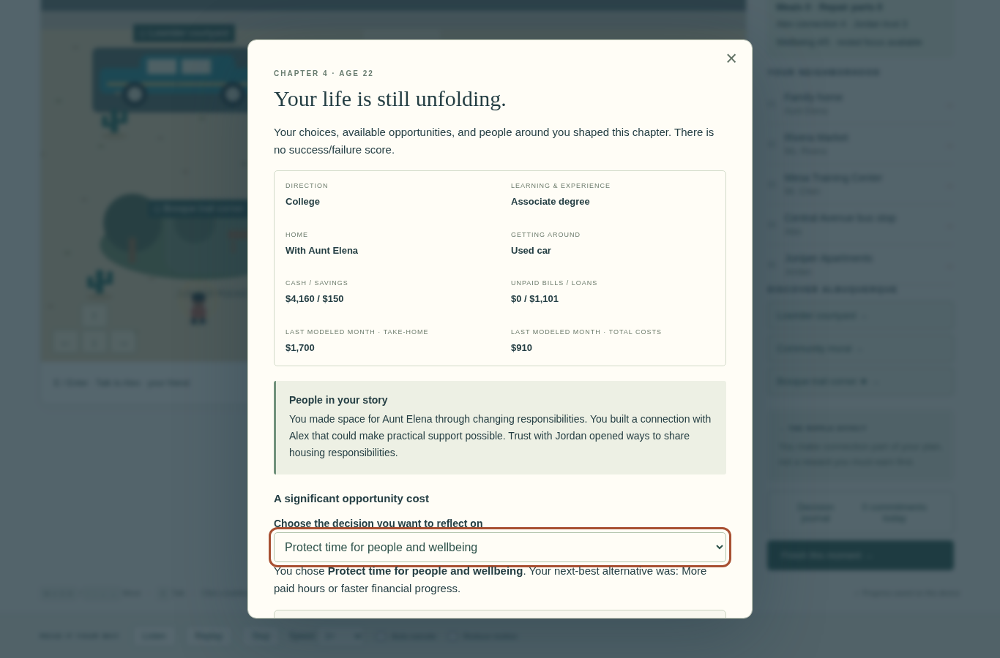

# The Butterfly Effect: The Cost of Every Choice

A complete four-chapter browser game about scarcity and opportunity cost, from graduation at 18 to a personalized Life Snapshot at 22. Built with Phaser 3, TypeScript, and Vite. No accounts, database, external artwork services, or API keys are required.


## Play

On the published site, choose **Begin your story** or **Continue saved story**. Existing graduation-day, first-week, and completed two-week saves can continue into the later chapters without losing choices or money.

1. **After graduation, age 18:** explore fourteen days in the neighborhood. Finish a day and choose **Start the next day**. At the end of week two, choose **Continue the story**.
2. **Finding a rhythm, ages 19–20:** choose work and learning arrangements, balance paid hours, and find housing.
3. **Changing plans, ages 20–21:** handle transport, a medical appointment conflict, and a job or business opportunity.
4. **Looking ahead, ages 21–22:** respond to rising rent, complete a learning goal or change direction, and decide what matters next.

In chapters 2–4, visit the **starred main location** first. Opening the story timeline shows the upcoming moments and current budget. Before the main choice, exploration does not use reserved appointment time. Afterward, optional activities compete for the remaining hours. **Finish this moment** shows the month's numbers before you settle them and continue.

At 22, choose an important decision, write a short reflection, and **Download Life Snapshot** or print it. There is no winner/loser score. Answers stay on the device and are not sent anywhere.

See the [teacher guide](docs/TEACHER_GUIDE.md) for classroom use.



## Controls and accessibility

- **WASD / arrow keys:** walk. Focus the canvas if a menu has keyboard focus.
- **E / Enter:** talk near an entrance or discovery.
- **Click a building or choose Locations:** visit directly. All essential interactions have HTML menu alternatives.
- **Directional buttons:** hold for touch/pointer movement.
- **Escape / ×:** close dialogue without making a choice.
- **Listen / Replay / Stop:** narration of the current panel and choices. Five speeds and automatic narration are available. Expand optional details before Listen to include them.
- **Reduce motion:** reduces walking animation. All essential information is visual as well as spoken.

The opening's walking costs five game minutes per fifteen seconds; direct visits take five minutes. Reading is free. Each place offers one commitment per day or later story moment. The calendar and story timeline show deadlines and changes. Autosaves use this browser's local storage. A fresh story replaces the save; download a snapshot first if you want to keep it.

## Financial model

The opening credits wages when a shift is completed. Days 7 and 14 each settle housing once: spending money first, then savings, then any unpaid balance. A shared room uses `ceil(monthly rent / 4)` as a simplified weekly share; family housing is $40/week.

Later chapters model **nine selected monthly budgets**, one per important moment. The game does not secretly credit or charge the months between those moments. This preserves a clear, inspectable connection between choices and outcomes rather than presenting invented four-year cash flows as a financial forecast.

Each month includes take-home income, housing (or a $160 family contribution), essentials, tuition, and an affordable planned loan payment. Essentials include food, transport, and ordinary costs. Variable independent-work income is determined by the saved story seed; the budget preview shows the actual month's amount. Loans accrue illustrative 6% APR, calculated as 0.5% in each modeled month. Loan payments cannot exceed funds remaining after basic expenses. Any other shortfall remains an unpaid bill, separate from loan principal.

Amounts, programs, and service events are fictional classroom scenarios, not current financial, housing, enrollment, medical, or lending advice.

## Features

- A walkable Albuquerque neighborhood with five recurring character locations and three discoveries: a lowrider courtyard, mural, and bosque trail corner.
- Four starting interests—college, employment, trades, and independent work—with opportunities to change direction.
- Scarce money, time, seats, shared tools, usable repair parts and meals, housing privacy, transport service, relationships, and wellbeing.
- Prior choices affect later tuition support, apprenticeship access, work references, shared rides, housing coordination, and learning time.
- Brief visual-novel dialogue, optional detail, daily prompts, and four economics reflection checkpoints including the final reflection.
- Local saves with backward-compatible continuation, a full journal, a personalized age-22 outcome, and printable/downloadable reflection.

World and portrait art are original procedural assets. The game uses no commercial game screenshots. Art can be refined later without changing the story or economic architecture.

## Run locally

Requires Node.js 22.12+ (tested with Node 24) and npm.

```sh
npm ci
npm run dev
```

Open the address Vite prints. A cloud workspace can preview port **5173**, if its UI supports port previews.

```sh
npm run build       # TypeScript validation + production output in dist/
npm run preview     # serve the production build on port 4173
```

If the workspace blocks the default npm cache, use `npm ci --cache /tmp/butterfly-npm-cache`.

## Browser tests

```sh
npm ci
npx playwright install chromium
npm test
```

The config uses system Chromium when `/usr/bin/chromium` exists and otherwise uses Playwright's downloaded Chromium. Override it with `CHROMIUM_PATH` if needed. The suite covers desktop and Chromebook viewport sizes, all four pathways from a fresh story through age 22, old saves, finances and loan interest, narration, interactions, and final reflection export. See [validation](docs/VALIDATION.md) for actual results and limits.

## Publish on GitHub Pages

The included workflow builds and deploys when reviewed code reaches `main`.

1. Merge the pull request after its checks pass.
2. Keep **Settings → Pages → Source** set to **GitHub Actions**.
3. Watch **Actions → Deploy game to GitHub Pages**. Your existing website updates after a successful deployment.

Vite uses a relative base to support repository Pages paths and custom domains. The game runs without third-party runtime requests. Offline caching is not included.

See [architecture](docs/ARCHITECTURE.md) for extension points and [completed scope](docs/ROADMAP.md) for the delivered game and optional future enhancements.
