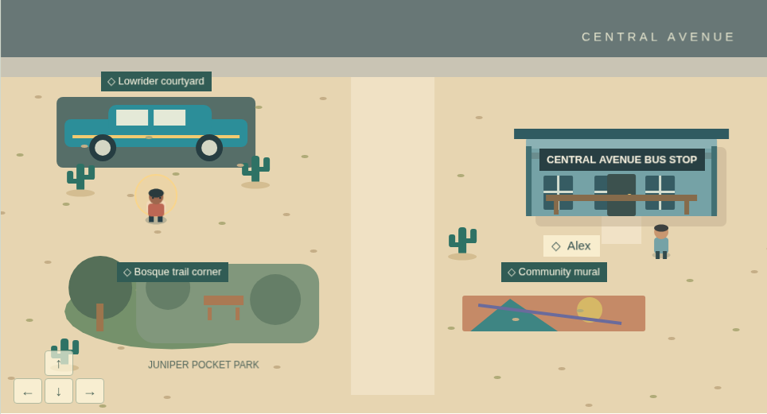
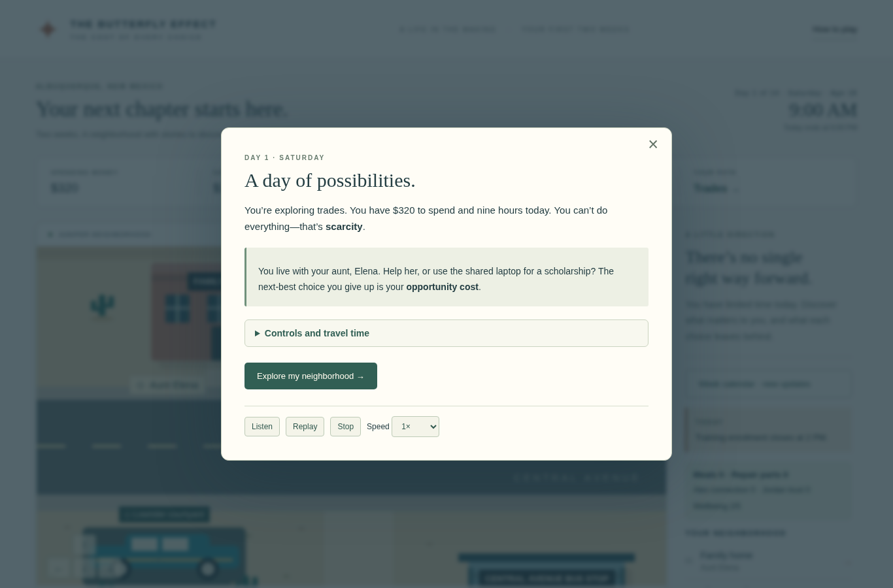

# The Butterfly Effect: The Cost of Every Choice

A playable fourteen-day opening chapter of a narrative economics game for high school seniors. Explore an original, illustrated Albuquerque neighborhood in Phaser 3, make commitments with limited time and resources, and reflect on the next-best alternatives you gave up.



## Play and develop

Requires Node.js 22.12+ (tested with Node 24) and npm.

```sh
npm ci
npm run dev
```

Open the address printed by Vite in your browser. In a cloud coding workspace, use its port preview for port **5173** if available. On your own computer the address is usually `http://localhost:5173`. This game needs no accounts, API keys, external artwork, or backend.

```sh
npm run build       # TypeScript validation and production output in dist/
npm run preview     # inspect the production build (port 4173)
```

If your workspace prevents writes to npm's default cache, add `--cache /tmp/butterfly-npm-cache` to `npm ci`.

## Controls

- **WASD / arrow keys:** walk. Click or focus the game canvas first if a menu button has keyboard focus.
- **E / Enter:** talk near a building entrance.
- **Click a building, sidebar location, or Locations:** travel to its entrance and start a conversation. Direct travel costs five game minutes.
- **Directional buttons:** hold to move on a touch screen.
- **Escape / ×:** close a dialogue. Closing without choosing makes no commitment.
- **Listen / Replay / Stop:** browser narration, with five speed settings and optional automatic reading. Voice availability depends on the browser/OS.

Walking costs five game minutes per fifteen seconds of movement. Reading dialogue uses no time. Each location offers one commitment per day. Use **Week calendar** to see deadlines. After finishing a day, choose **Start the next day** in the journal. All costs and requirements appear before choosing. Finish the day whenever you wish; the decision journal and reflection are available at any time. Your progress is automatically saved to this browser's local storage. New stories replace that save. Download the reflection before restarting if you want to keep it. Shared school devices should start a fresh story between students.

## What this milestone includes

- A title screen, four selectable starting interests, changeable pathway, accessible introduction, and five interactive locations.
- Smooth accelerated movement, directional walking frames, building/plant collision, camera following, and keyboard, mouse, menu, and touch navigation.
- Fourteen playable days with new conversations across all five locations. A calendar, paid work, interviews, career applications, shared equipment, clinic conflicts, groceries, and Friday housing bills make choices carry forward.
- Training opens a carpool and a reserved Tuesday workshop. Helping Elena reduces the room deposit. Tuesday’s reduced bus service adds 90 minutes to each work or learning commitment for city-bus riders. A bike, carpool, or planned ride changes that trade-off. Time already spent cannot be recovered.
- Short dialogue, clear time/money summaries, and optional **Tell me more** sections. Narration reads the current visible panel, including every choice and reason an option is unavailable. Expand a detail section before Listen to include it.
- Different daily reflection prompts, checkpoints after three commitments and each week, and a downloadable decision summary. This remains an **age-18 snapshot**, not the planned four-year life simulation. Existing graduation-day and completed first-week saves continue without losing resources, choices, or earlier bill payments.

Original scenery and character art are drawn in code. These are cohesive prototype assets designed to be replaceable; no commercial game assets are used. Monetary amounts and availability are illustrative classroom scenarios, not current financial or enrollment advice. Work pays immediately after each completed shift; accepting a schedule does not pay wages. Expected weekly income is a planning estimate. The housing deposit is separate from Friday’s bill: $125 for the shared room (a simplified four-week share of $500/month), or a $40 household contribution when living with family. Friday’s bill uses spending money, then savings. Any remaining amount becomes an unpaid housing balance, without interest or a failure score. Housing is charged once on each Friday (days 7 and 14), including after reloads. A later smaller-room option costs $350/month, modeled as $88/week, in exchange for less privacy.

Temporary family/shared rides apply only to Tuesday; the previous travel plan returns the next morning. Grocery spending is a selected decision, not a hidden recurring deduction. This milestone does not simulate all living expenses, formal loans, or the consequences of a long-term overdue balance. In week two, a player can pay down an unpaid balance.

## What changed after classroom playtesting

- Aunt Elena is introduced as the aunt you live with. Character name banners sit beside the characters.
- Day 2 has a real work/advising conflict. The journal counts commitments without presenting every location as a checklist to finish.
- Explore the **lowrider courtyard**, **community mural**, and **bosque trail corner** by walking, clicking, or using the map. Their stories and choices affect skills, parts, wellbeing, and relationships.
- New stories have different daily pop-ups and weather notices. Events stay fixed on reload. Read **Week calendar · new updates** each morning to see the current bulletin.
- Time with Alex builds a specific connection. At 2, a bike loan opens. Rest and connection also improve wellbeing; rested focus helps later learning. Bikes remain available to buy after the route change.
- Groceries provide three packed meals in one hour for $20. Community pickup provides one meal in two hours, at no cash cost. Each meal can save $8 on a week-two shift. Neither route is a universal answer: cash, supply, and opening hours differ.
- Housing includes research, viewings, privacy, maintenance coordination, trust, and a lower-rent option. Quiet space can shorten study; lower rent can mean less privacy.
- Repair parts and minimum skill requirements create limits even with hours left. Earlier choices can open a paid repair, job trial, or apprenticeship application.

Some days intentionally leave room for exploration, rest, and relationships. The objective is not to exhaust every hour or maximize one score.



## Automated browser tests

```sh
npm ci
npx playwright install chromium
npm test
```

The config uses `/usr/bin/chromium` when installed, and otherwise uses Playwright’s downloaded Chromium. You can optionally set `CHROMIUM_PATH` to another Chrome/Chromium executable.

The suite runs the actual game at 1440×1000 and Chromebook-sized 1366×768 viewports. It covers new/continued/restarted stories, all locations, linked decisions and arithmetic, deadlines, affordability, narration controls, speed, map navigation, movement, keyboard dialogue, reflection, ending, both weeks, old-save continuation, Friday settlement and shortfall handling, discovery sites, daily events, packed meals, parts, friendship support, privacy, and changing reflections, responsive layout, and browser/asset errors. See [validation notes](docs/VALIDATION.md) for the current run and limits.

## Publish on GitHub Pages

The included **Deploy game to GitHub Pages** workflow builds and publishes `dist/` when changes reach `main`, or when run manually.

1. Merge the game pull request into `main` (or push the reviewed code there).
2. In your repository, open **Settings → Pages → Build and deployment → Source**, and select **GitHub Actions**.
3. Open **Actions → Deploy game to GitHub Pages**. Wait for the deployment to succeed.
4. The deployment summary and **Settings → Pages** show your game link. Share that link with students; they need only a browser.

The relative Vite base supports repository Pages paths and custom domains. The site runs without third-party runtime requests. A service worker/offline-first mode is not part of this milestone.

For changes and file organization, see [architecture](docs/ARCHITECTURE.md). For the remaining game, see [roadmap](docs/ROADMAP.md).
